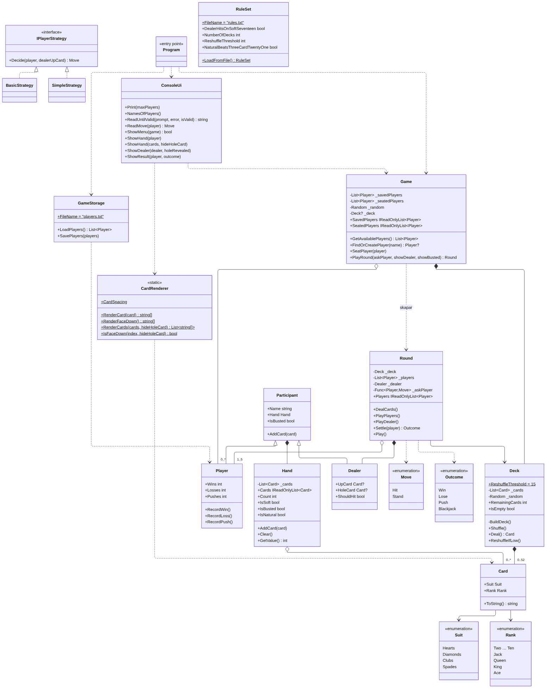
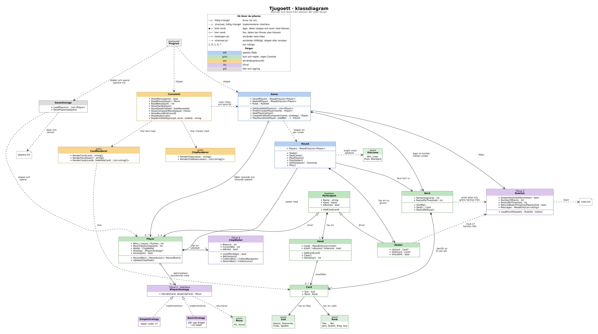

# Tjugoett (Blackjack)

Konsolspel i C#: 1–5 spelare mot en given. Byggs i Kunskapskontroll 3, MAI26.
Klasser och metoder på engelska, allt användaren ser på svenska.

## Så startar man

```
dotnet run --project Blackjack.csproj
```

## Styrning

| Skärm | Kontroller |
|---|---|
| Huvudmeny | `↑`/`↓` (eller `1`–`5`) markera, `Enter` välja, `Esc` avsluta |
| Spelare | `j` lägg till, `1` starta runda, `Enter`/`Esc` tillbaka |
| Highscores | `1` flest vinster, `2` flest förluster, `3` namn A–Ö, `Enter`/`Esc` tillbaka |
| Regler | `Enter`/`Esc` tillbaka |
| Runda | `k` köpa, `s` stanna (även piltangenterna: `→` köpa, `←` stanna) |

I en interaktiv konsol färgsätts den valda menyposten och den aktiva
spelaren. Korten ritas som kort (US12): valör i hörnen, färg i mitten,
givarens hålkort dolt (baksidan upp) tills det vänts. Livebordet ritas
som en grön blackjack-matta i stil med ett casino-bord: guldplåt
"BLACKJACK", givarens kort överst och spelarna sida vid sida i sina
säten – mattans bredd anpassas efter antalet spelare (1–5) och
konsolruttens bredd, så att alla säten ryms i en enda rad och brädet
aldrig viker om. Varje spelare har namn och värde överst, kort i
mitten och sin insats under korten – både som text ("insats 50") och
som färgade satsningschips (1–100, varje chip med sin casinofärg).

## Översikt över klasserna

| Klass | Ansvar | Story |
|---|---|---|
| Suit, Rank | Enum:ar för färg och valör | US04 |
| Card | Ett kort: färg + valör | US04 |
| Deck | Bygger lek, blandar (Fisher-Yates), delar ut, räkna kort | US04/US05 |
| Hand | Samling kort: värde, mjuk/hård, spräckt, naturlig 21 | US06 |
| Participant | Bas: namn + hand | US07 |
| Player | Ärver Participant: statistik (inkl. mest antal marker under spel), sitter vid bordet | US01/US02/US07/US15 |
| Dealer | Ärver Participant: hålkort + fast regel | US07 |
| Round | En giv: deal, turer, givarens tur, avgörande | US08 |
| Game | Meny och spelloop | US02/US03/US09 |
| Move, Outcome | Enum:ar – drag och utfall | US07 |
| IPlayerStrategy | Gränssnitt: datorspelarens beslut | US13 |
| SimpleStrategy, BasicStrategy | Datorstrategier: köpa <17 / tabell | US13 |
| GameStorage | Spara/ladda spelare + resultat | US10 |
| RuleSet | Husregler: antal lekar, mjuk 17, omblandning, naturlig 21 | US14 |
| ChipWallet | Marker per spelare: satsa, vinst, förlust, utbetalning | US15 |
| ConsoleUi | All in- och utmatning: meny, highscores, regler, livebord (grön matta med chips) | US11 |
| CardRenderer | Kortgrafik: kort som rader med box-drag | US12 |
| ChipRenderer | Chipgrafik: satsningschips som färgade textrutor | US12/US15 |

## Vem har gjort vad

| Gruppmedlem | Tillval | Branch |
|---|---|---|
| Daniel Norberg | 2 – Datorspelare med strategi | US13-Computer-players |
| Andreas | 3. Husregler från konfigurationsfil | feature-house-rules |
| Hadi Bahaulddin | 1 – Kortgrafik | feature-card-graphics, US18-visa-hander |
| Emil Chau | 4 – Satsningar och marker | US15-Chips-bets |

**Tillval 1 – Kortgrafik (Hadi):** Jag gjorde så att korten visas som riktiga kort i terminalen, bredvid varandra. Hjärter och ruter är röda, klöver och spader är svarta. Givarens dolda kort visas med baksidan upp tills det vänds. CardRenderer ritar korten och ConsoleUi skriver ut dem i färg. Livebordet ritas som en grön blackjack-matta (casino-stil) med guldplåt "BLACKJACK", givaren uppe och varje spelares insats liggande framför hen som satsningschips (1–100, var med sin färg som riktiga casinochips) – ChipRenderer ritar chipens form och ConsoleUi sätter färgen, samma uppdelning som för korten.

Jag fixade också några buggar som vi hittade när vi testade: naturligt 21 mot 21 med tre kort, att spelet kraschade när korten tog slut, max 5 spelare vid bordet och att "Dama" skulle vara "Dam".

**Tillval 2 – Datorspelare med strategi (Daniel Norberg):** Direkt efter valet av antal spelare (totalt antal: mänskliga + datorer) väljer man hur många av dem som ska vara datorspelare. Det måste alltid bli minst en mänsklig spelare, så max antal datorer är de valda spelarna minus ett. Varje datorspelare får automatiskt ett namn ("Dator 1", "Dator 2", …) och en strategi – antingen den enkla (köpa under 17) eller grundstrategin (tabell). Dator- och mänskliga spelare sitter samtidigt vid bordet och Round vet inte skillnaden: beslutet levereras in som en funktion där `Program.cs` väljer mellan `ConsoleUi` och `IPlayerStrategy`. Mänskliga spelare spelar först i tur och ordning, sedan datorspelarna. Datorspelare sparas inte i `players.txt`.

**Tillval 3 - Husregler från konfigurationsfil (Andreas):** Husreglerna läses från `rules.txt` vid start (tillval 3). Standardvärdena följer specen från uppgiften. Saknas filen eller är ett värde fel används standardvärdet och en varning visas. Standardvärdena enligt specen i uppgiftsbeskrivningen är 52 kort, givaren stannar på mjuk 17, naturlig 21 betalar enligt avgörandetabellen och omblandning vid <15 kort.

**Tillval 4 – Satsningar och marker (Emil Chau):** Varje spelare har en plånbok (`ChipWallet`) med marker, och nya spelare startar med 100. Innan korten delas ut frågar `ConsoleUi` hur många marker man vill satsa, och svaret valideras så att insatsen varken är noll eller större än saldot. Vinst betalar 1:1, naturlig tjugoett betalar 3:2 (avrundas nedåt vid udda insats) och lika ger insatsen tillbaka. `Round` pratar aldrig med konsolen: insatsen skickas in som en funktion (`Func<Player, int>`), på samma sätt som spelarens beslut, och utbetalningen sker i `Round.Play()` och inte i `Settle`, som är ren och anropas igen för att visa resultatet. Saldot sparas i `players.txt` och visas i spelarlistan. En spelare som får slut på marker lämnar bordet efter rundan (`Game.RemoveBrokePlayers`), kan inte sättas ned igen och markeras med "SLUT PÅ MARKER".
## Regler som gäller
Husreglerna läses från `rules.txt` vid start (tillval 3). Standardvärdena följer specen. Saknas filen eller är ett värde fel används standardvärdet och en varning visas.
Enligt specen i uppgiftsbeskrivningen är standard reglerna följande: 
- 52 kort 
- Givaren stannar på mjuk 17,
- Naturlig 21 betalar enligt avgörandetabellen
- Omblandning vid <15 kort.

## Kända brister

- US15: försäkring (överkurs) saknas.

## Klassdiagram




Källfilen finns i `docs/klassdiagram.md` och uppdateras när koden ändras.

## User stories

Se [docs/user-stories.md](docs/user-stories.md).
